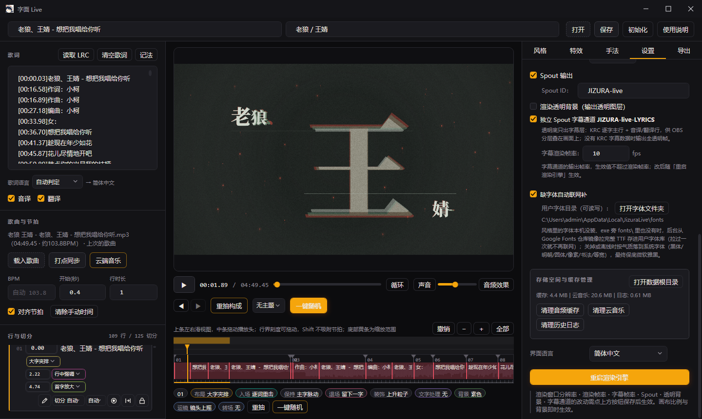

<div align="center">

  

  <h1>JIZURA Live（字面 Live）</h1>

  <p>Windows 平台下的歌词 PV 动效生成与实时排版工具</p>

  <p>
    <a href="./LICENSE"></a>
    <a href="https://dotnet.microsoft.com/"></a>
    
  </p>

  <br />

  

</div>

---

## 项目简介

JIZURA Live 是一款运行在 Windows 平台上的歌词 PV 动效生成与实时排版工具。它支持导入音频与歌词文本，通过内置的排版规划器、动效手法与相机运镜快速生成视觉化动态歌词，并提供视频导出与直播推流支持。

当前版本为 **3.0（Pure C#）**。该版本移除了早期版本依赖的 CEF（Chromium Embedded Framework）浏览器内核与 Web 前端架构，基于原生 WPF 与 SkiaSharp 重写了完整的用户界面与自绘渲染管线，大幅降低了运行时的内存开销与多进程通信延迟。

---

## 核心特性

- **纯 C# 原生渲染管线**：核心渲染引擎基于 SkiaSharp 构建，支持入场、驻留、退场、背景、装饰、转场与摄像机手法组合。支持 Direct3D 11 / ANGLE GPU 光栅化，缺乏硬件支持时自动平滑回退至 CPU 光栅。
- **智能排版与 Omakase 生成**：内置自动排版规划器（Planner）与 Omakase 算法，可根据歌词节奏与切分结构自动规划视觉层级与手法搭配，同时支持单行、单切分手法的精确手动覆盖与参数调整。
- **歌词与节拍同步**：支持标准 LRC 时间戳与行内切分记法（`/` 切分、`*强调*`、`!闪烁`、`[间奏 N]` 等），支持 BPM 节拍推算以及手动打点同步（Tap Sync）。
- **多格式导出引擎**：通过管道调用 FFmpeg，支持导出高质量 MP4 视频、带透明通道的字幕层 WebM 视频，以及 PNG 序列帧（透明背景或图层分层）。
- **实时推流输出（Spout2）**：集成 SpoutDX 纹理共享功能，可在播放时将渲染画面直接输出至 OBS Studio、Resolume 等导播与 VJ 软件，作为低延迟动态歌词源。
- **音频与字体生态**：支持本地音频文件与云端音乐搜索/歌单载入；内置字体回退机制，扫描本地与系统字体库，必要时可自动按需匹配开源字体。
- **MCP 协议驱动（Model Context Protocol）**：内置基于标准 `HttpListener` 的无状态 HTTP MCP 服务，向 AI 代理（如 ZCode、Claude）暴露 17 个标准化操作工具，支持纯文本无头操控完成歌词制作、风格微调与导出全流程。

---

## 运行与开发环境

### 系统与环境要求
- **操作系统**：Windows 10 64 位（版本 19041 或更高版本）
- **开发框架**：.NET 10.0 SDK（`win-x64`）
- **图形要求**：支持 DirectX 11 的显卡

### 运行时原生依赖
1. **SpoutDX**：`SpoutDX.dll` 与 `SpoutDXWrapper.dll` 已存放在 `native/` 目录下，项目编译时会自动复制到输出根目录。
2. **ANGLE 运行库**（可选 GPU 加速）：存放在 `native/angle/`（包含 `d3dcompiler_47.dll`、`libEGL.dll`、`libGLESv2.dll`），编译时会复制到输出目录下的 `angle/` 文件夹。如未找到，应用会自动使用 CPU 光栅模式运行。
3. **FFmpeg**：视频导出依赖 `ffmpeg.exe`。导出前请确保程序根目录包含 FFmpeg 二进制文件，或已将其添加至系统环境变量 `PATH` 中。

---

## 构建与发布

### 1. 还原与编译
在项目根目录下执行：

```bash
# 调试构建
dotnet build

# 发行构建
dotnet build -c Release
```

### 2. 自包含发布
生成不依赖目标机器 .NET 运行时的独立运行包：

```bash
dotnet publish -c Release -r win-x64 --self-contained
```

发布产物将输出至 `bin/publish/` 目录。

### 3. 打包安装程序
项目提供了 Inno Setup 配置文件 `build.iss`。在完成发布后，使用 Inno Setup 6 编译该脚本即可在 `Output/` 目录下生成单文件安装包：

```bash
iscc build.iss
```

---

## 目录结构

```
JIZURA-Live/
├── assets/                 # 应用图标、内置字体等静态资源
├── native/                 # 原生动态链接库（SpoutDX、ANGLE）
├── src/
│   ├── App/                # WPF 桌面宿主、窗口与视图、ViewModel、编辑器状态与 MCP 服务
│   │   ├── Cloud/          # 云端音频与歌词接口
│   │   ├── Controls/       # 自定义控件与界面组件
│   │   ├── I18n/           # 多语言词库（内置中英本地化）
│   │   ├── Mcp/            # Model Context Protocol 服务实现（McpHttpServer、McpTools）
│   │   └── Views/          # 视图面板（歌词编辑、效果调优、导出窗口等）
│   ├── Engine/             # 核心排版与 SkiaSharp 渲染引擎
│   │   ├── Packs/          # 手法与效果资产预设
│   │   ├── JFonts.cs       # 字体扫描、解析与网络回退
│   │   ├── JLayouts.cs     # 文本排版与几何布局算法
│   │   ├── Omakase.cs      # 智能风格搭配与随机生成算法
│   │   ├── Planner.cs      # 时间线与切分规划器
│   │   └── Renderer.cs     # 帧级画布绘制与图层渲染器
│   ├── Export/             # 导出管线（FFmpeg 进程编排、PNG 序列帧生成）
│   ├── Logging/            # 日志记录模块（log4net 封装）
│   ├── Server/             # 局域网传输与辅助服务
│   └── Spout/              # SpoutDX 共享纹理跨进程互操作
├── tests/                  # 单元测试与对拍验证工程
├── tools/                  # 辅助工具与测试工程文件
├── DOC/                    # 文档、图元资产与协议规范（MCP 规范、AI 技能说明等）
│   ├── icon.png            # 应用高清图标
│   ├── screenshot.png      # 软件运行界面截图
│   ├── MCP.md              # MCP 接入协议与架构文档
│   └── SKILL.md            # AI 代理操作技能指南
├── build.iss               # Inno Setup 打包脚本
├── JizuraLive.csproj       # 项目主工程文件
└── LICENSE                 # 开源许可证文件（GPL-2.0）
```

---

## MCP 接入说明

JIZURA Live 启动后会在后台开启 HTTP MCP 服务（默认监听 `127.0.0.1:8642`，端口被占用时自动向后顺延）。

### 客户端配置示例
在支持 MCP 的客户端（例如 ZCode 的 `.zcode/config.json` 或 Claude Desktop 配置文件）中添加：

```json
{
  "mcp": {
    "servers": {
      "jizura": {
        "type": "http",
        "url": "http://127.0.0.1:8642/mcp"
      }
    }
  }
}
```

### 接口快速测试
在应用运行状态下，可通过终端发送标准 JSON-RPC 2.0 请求进行握手验证：

```bash
# 握手测试
curl -s -X POST http://127.0.0.1:8642/mcp \
  -H "Content-Type: application/json" \
  -d '{"jsonrpc":"2.0","id":1,"method":"initialize","params":{"protocolVersion":"2025-06-18"}}'

# 获取当前工具列表（17 个工具）
curl -s -X POST http://127.0.0.1:8642/mcp \
  -H "Content-Type: application/json" \
  -d '{"jsonrpc":"2.0","id":1,"method":"tools/list"}'
```

关于完整的 MCP 工具定义、工作流协议与 revision 状态机制，请参阅 [DOC/MCP.md](DOC/MCP.md) 与 [DOC/SKILL.md](DOC/SKILL.md)。

---

## 许可证

本项目依据 **GNU General Public License v2 (GPL-2.0)** 许可协议分发与使用。完整协议文本请参阅项目根目录下的 [LICENSE](LICENSE) 文件。
